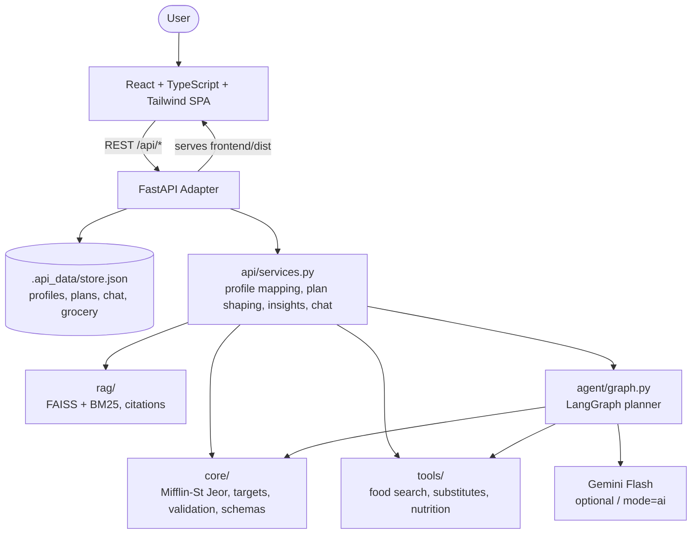

# 🌿 NutriPlan — AI Food and Nutrition Planning Agent

A production-style nutrition product with a React + TypeScript frontend, a FastAPI REST layer, and the original LangGraph/Gemini/FAISS engine as the source of truth. It computes personalized energy requirements from curated Indian food data (ICMR-NIN/IFCT), builds balanced 7-day meal plans, tracks macros plus 17 micronutrients, and explains every recommendation through a cited AI Nutritionist.

[](https://www.python.org/)
[](https://react.dev/)
[](https://fastapi.tiangolo.com/)
[](https://deepmind.google/technologies/gemini/)
[](https://langchain-ai.github.io/langgraph/)
[](https://streamlit.io/)
[-brightgreen.svg)](tests/)
[](rag/)

---

## 📌 Problem Statement

Dietary planning in India often suffers from:
1. **Generic Advice:** Western diet formulas ignore Indian staple food compositions, cooking mediums, and carbohydrate-to-protein distributions.
2. **Allergen & Preference Violations:** Manually crafted plans or standard LLMs frequently hallucinate or accidentally suggest non-vegetarian foods or allergen-tagged items (e.g. dairy or peanuts).
3. **Caloric Imbalance:** Plans frequently miss daily caloric and macronutrient targets by substantial margins without self-correcting mechanisms.

---

## 🎯 Objectives

- **Scientific Calculation Engine:** Implement the **Mifflin-St Jeor** formula to calculate Basal Metabolic Rate (BMR), adjust for Physical Activity Level (PAL) to compute Total Daily Energy Expenditure (TDEE), and derive goal-specific daily macronutrient targets.
- **Curated Indian Dataset:** Compile an authenticated 57-item Indian food composition dataset based on **ICMR-National Institute of Nutrition (NIN)** data with vegetarian, non-vegetarian, macronutrient, allergen, and glycemic index tags.
- **Agentic AI & Self-Healing Loop:** Leverage **Google Gemini Flash** bound with 7 specialized Python tools and a 7-node **LangGraph** StateGraph that automatically validates meal plans and triggers up to 2 corrective revisions if constraints are violated. A model fallback chain and deterministic offline answers keep every feature working when a model is retired or the API is unreachable.
- **Interactive Web Interface:** Provide a responsive Streamlit dashboard with biometric metric cards, meal-wise breakdown tables, distribution charts, a multi-turn chat assistant with session memory, and an optional one-question-at-a-time profile wizard alongside the classic form.

---

## 🛠️ Technologies Used

| Layer | Technology | Purpose |
|---|---|---|
| **Frontend (primary)** | React 19, TypeScript, Vite, Tailwind CSS, Radix UI, Framer Motion, Recharts | Landing, onboarding wizard, dashboard, planner, recipe, chat, insights, grocery, library, profile |
| **Backend API** | FastAPI, Uvicorn, Pydantic | REST adapter for auth, profiles, plans, foods, chat, grocery, favorites, history, insights, export |
| **State & API client** | Zustand, Axios | Client state, hydration, typed REST calls (`VITE_API_URL` override) |
| **AI reasoning** | Google Gemini Flash (`gemini-flash-lite-latest`) | Optional LangGraph planning (`mode="ai"`) and opt-in chat (`API_USE_GEMINI_CHAT`) |
| **Agent framework** | LangGraph & LangChain Core | StateGraph orchestration, conditional edges, memory checkpointer (unchanged engine) |
| **Knowledge retrieval (RAG)** | FAISS + pure-Python BM25, HuggingFace (`all-MiniLM-L6-v2`) | Hybrid dense/lexical retrieval and cited chat context |
| **Data & validation** | Pandas, NumPy, Pydantic v2 | ICMR-NIN/IFCT dataset operations, validated request/response contracts |
| **Testing** | Pytest | 184-test suite covering core, agent, RAG, UI, and REST API |
| **Legacy UI** | Streamlit (`app.py`) | Kept for reference; React/FastAPI is the primary product UI |

---

## 🏛️ System Architecture



> **Engine-first rule:** `core/`, `tools/`, `rag/`, `agent/`, and `data/` remain the source of truth. The FastAPI layer is additive and adapts their outputs to the React client. Legacy Streamlit (`app.py` + `ui/`) remains in-repo.

---

## 🧰 Python Tools

The agent invokes seven dedicated Python tools:

1. **`calculate_nutrition_targets`**: Derives BMI, BMR, TDEE, Calorie targets, and Protein, Carbohydrate, Fat, and Fiber gram goals.
2. **`search_food_database`**: Vectorized search filtering by diet type (`veg`/`non-veg`), meal slot (`breakfast`, `lunch`, `snack`, `dinner`), calorie cap, and excluded allergen tags.
3. **`calculate_meal_nutrition`**: Computes exact cumulative calories and macro breakdown for any combination of foods and gram portion sizes.
4. **`find_food_substitutes`**: Identifies alternative foods ranked by **cosine similarity** on the normalized macro vector `[calories, protein, carbs, fats, fiber]`.
5. **`validate_meal_plan`**: Enforces strict deterministic rules:
   - Presence of all required meals (Breakfast, Lunch, Dinner).
   - Positive portion sizes (> 0g).
   - Zero non-vegetarian items in vegetarian plans.
   - Zero allergen items in restricted plans.
   - Zero user-excluded foods.
   - Planned calories strictly within **±15%** of target.
6. **`retrieve_nutrition_knowledge`**: Distance-filtered ICMR-NIN RAG tool with
   composed answers and source/page citations.
7. **`retrieve_hybrid_nutrition_knowledge`**: Fuses dense FAISS + BM25 with
   reciprocal rank fusion across the core and condition indexes, and appends a
   deterministic citation-verification result to every answer.

---

## 📂 Project Structure

```text
Food-and-Nutrition-Planning-Agent/
├── app.py                      # Legacy Streamlit entry point (kept for reference)
├── requirements.txt            # Python dependencies (engine, RAG, FastAPI)
├── api/                        # FastAPI REST adapter (additive layer)
│   ├── main.py                 # App, routes, auth, SPA fallback, error handling
│   ├── services.py             # Adapts core/agent/tools/rag to REST responses
│   ├── store.py                # JSON-backed local persistence under .api_data/
│   ├── schemas.py              # Request/response models
│   └── recipes.py              # Additive recipe metadata, images, “why this meal”
├── frontend/                   # React + TypeScript + Vite + Tailwind (primary UI)
│   ├── src/
│   │   ├── pages/              # Landing, Auth, Onboarding, Dashboard, Planner, Recipe, …
│   │   ├── components/         # Layout, MealCard, FoodImage, UI primitives
│   │   ├── lib/                # api.ts, store.ts (Zustand), types.ts, utils.ts
│   │   └── index.css           # Tailwind theme tokens and design utilities
│   ├── public/images/          # Local SVG fallbacks (hero, breakfast, lunch, snack, dinner)
│   └── package.json            # npm scripts: dev, build, preview, lint
├── core/                       # Unchanged: profile, calculations, schemas, validation, …
├── agent/                      # LangGraph state graph, nodes, prompts (unchanged)
├── tools/                      # Nutrition/food tools (unchanged)
├── rag/                        # FAISS + BM25 hybrid retrieval, ingestion, evaluation
├── data/                       # food_data.csv, micronutrient_data.py, …
├── knowledge_base/             # PDFs and FAISS indexes (core + conditions)
├── ui/                         # Legacy Streamlit UI modules
├── tests/                      # Pytest suite (184 tests, including tests/test_api.py)
│   └── test_api.py             # FastAPI adapter tests
├── .api_data/                  # Local JSON state (auto-created, git-ignored)
└── evidence/
```

> **Reference-document note:** `knowledge_base/nutrition_documents/` contains a
> generated reference PDF used by the bundled demo index. Its text is a curated
> summary written for demonstration, not the official ICMR-NIN publication. For
> production use, replace it with the official ICMR-NIN Dietary Guidelines PDF
> and rebuild the index with `python -m rag.ingest --collection core --rebuild`
> (see [knowledge_base/SOURCES.md](knowledge_base/SOURCES.md) for full provenance
> of both document collections).

---

## 🚀 Installation & Running

### 1. Clone and set up Python
```bash
git clone https://github.com/MatamDarshan/Food-and-Nutrition-Planning-Agent.git
cd Food-and-Nutrition-Planning-Agent
python -m venv venv
# Windows: venv\Scripts\activate
# Linux/macOS: source venv/bin/activate
pip install -r requirements.txt
```

### 2. Configure environment (optional for AI mode)
```bash
cp .env.example .env
# Edit .env:
# GOOGLE_API_KEY=your_gemini_api_key_here
# MODEL_NAME=gemini-flash-lite-latest
```
- The deterministic planner works without an API key.
- `mode="ai"` plan generation requires `GOOGLE_API_KEY`.
- Chat uses grounded RAG answers by default; set `API_USE_GEMINI_CHAT=1` to opt into Gemini rewriting (requires key).

### 3. Build the React frontend
```bash
cd frontend
npm install
npm run build
cd ..
```

### 4. Run the FastAPI app (serves built frontend + API)
```bash
python -m uvicorn api.main:app --reload --port 8000
```
Open `http://localhost:8000`. If `frontend/dist` exists, FastAPI serves the SPA with client-side routing fallback.

### 5. Frontend dev mode (hot reload)
```bash
# Terminal 1
python -m uvicorn api.main:app --reload --port 8000

# Terminal 2
cd frontend
npm run dev
```
Vite runs on `http://localhost:5173` by default. Set `VITE_API_URL=http://localhost:8000` in `frontend/.env` if needed (defaults to `http://localhost:8000`).

### Demo account
- **Endpoint:** `POST /api/auth/demo`
- **Email:** `demo@nutrition.local`
- **Password:** `demo1234`
- The UI also has a “Try the demo” / demo-signin flow.

### Local state
- API state is stored in `.api_data/store.json` (users, tokens, profiles, plans, chat, favorites, history, checklist).
- `.api_data/`, `frontend/dist/`, and `frontend/node_modules/` are git-ignored.

### Legacy Streamlit app (reference)
```bash
streamlit run app.py
```
The Streamlit UI is preserved for reference; the React app is the primary frontend.

### Knowledge base (optional rebuild)
Both FAISS indexes are shipped. To rebuild:
```bash
python -m rag.ingest --collection core --rebuild
python -m rag.ingest --collection conditions --rebuild
```

---

## 🔌 REST API (FastAPI)

Base URL: `http://localhost:8000` (dev). All `/api/*` routes except health/auth/signup/signin/demo require `Authorization: Bearer <token>`.

| Area | Endpoints |
|---|---|
| **Health/Auth** | `GET /api/health`, `POST /api/auth/signup`, `POST /api/auth/signin`, `POST /api/auth/demo`, `GET /api/auth/me`, `POST /api/auth/signout` |
| **Profile/Targets** | `GET/PUT /api/profile`, `POST /api/targets` |
| **Plans** | `POST /api/plans/generate`, `GET /api/plans/current`, `GET /api/plans`, `GET /api/plans/{id}`, `POST /api/plans/{id}/regenerate`, `POST /api/plans/{id}/swap`, `GET /api/plans/{id}/recipe`, `GET /api/plans/{id}/export`, `DELETE /api/plans/{id}` |
| **Foods** | `GET /api/foods/search`, `GET /api/foods/substitutes` |
| **Chat** | `POST /api/chat`, `GET /api/chat/history`, `DELETE /api/chat/history` |
| **Grocery/Insights** | `GET /api/grocery`, `POST /api/grocery/check`, `GET /api/insights` |
| **Favorites/History** | `GET/POST /api/favorites`, `GET/POST /api/history` |

**Notes:** plan generation defaults to deterministic `mode="fast"`; `mode="ai"` uses LangGraph/Gemini when configured. Recipe prep steps are suggested (additive metadata), not sourced from IFCT. The React SPA is served by FastAPI when `frontend/dist` exists.

---

## 🧪 Testing & Evaluation Results

Run the full automated test suite:
```bash
pytest tests/ -v
```

### Summary of Results
- **Collected:** 184 test cases across 15 test modules (includes `tests/test_api.py`)
- **Passed:** 184 (100% Pass Rate, plus 1 non-blocking warning)
- **Execution Time:** ~2 minutes (fully offline and deterministic for most tests)

### API quick smoke (optional)
```bash
python -m uvicorn api.main:app --port 8000
# In another shell, try:
curl http://localhost:8000/api/health
```

### Module Breakdown
| Test Module | Coverage Area | Status |
|---|---|---|
| `test_calculations.py` | Mifflin-St Jeor BMR, TDEE, macro splits, validators (20 tests) | ✅ 20 PASS |
| `test_tools.py` | Vectorized food search, macro calculation, substitutions, validation (10 tests) | ✅ 10 PASS |
| `test_agent.py` | LangGraph nodes, state routing, conditional edges, retry limits (9 tests) | ✅ 9 PASS |
| `test_functional_evaluation.py` | End-to-end user journeys: Veg, Non-Veg, Allergies, Substitutions (10 tests) | ✅ 10 PASS |
| `test_offline_and_live.py` | Graceful offline demo planner & chat fallback (4 tests) | ✅ 4 PASS |
| `test_rag.py` | PDF loading, chunking, embeddings, FAISS search, distance rejection (22 tests) | ✅ 22 PASS |
| `test_7day_upgrade.py` | 15-scenario verification: 7-day plans, allergens, micronutrients, calculations (15 tests) | ✅ 15 PASS |
| `test_complete_system_verification.py` | End-to-end biometrics, tools, multi-user planning, RAG, chat, UI imports (10 tests) | ✅ 10 PASS |
| `test_regressions.py` | Nested JSON parsing, malformed-plan safety, allergen consistency, stale state (11 tests) | ✅ 11 PASS |
| `test_audit_validation_and_accuracy.py` | Audit of validation, micronutrients and profile-aware chat safety (13 tests) | ✅ 13 PASS |
| `test_ui_frontend.py` | Streamlit AppTest smoke tests for all five pages and chips (8 tests) | ✅ 8 PASS |
| `test_ingestion.py` | Manifest, dry-run/rebuild ingestion and condition retrieval (12 tests) | ✅ 12 PASS |
| `test_hybrid_and_citations.py` | BM25, RRF fusion, filtering and citation verification (16 tests) | ✅ 16 PASS |
| `test_profile_wizard.py` | Headless wizard state machine, parsing, skips, retry and AppTest chat flow (13 tests) | ✅ 13 PASS |
| `test_api.py` | FastAPI REST adapter: auth, profile/targets, plan generate/swap/regenerate, grocery/insights/export, foods, chat citations, favorites/history (11 tests) | ✅ 11 PASS |

Run the dedicated 16-query RAG factual accuracy and rejection benchmark:
```bash
python rag/evaluate_rag.py
```

### Functional Verification Matrix
| Scenario | Requirement | Status |
|---|---|---|
| **Vegetarian Diet** | Only vegetarian items recommended (no poultry/meat/fish) | ✅ PASS |
| **Non-Vegetarian Diet** | Suitable non-vegetarian options included | ✅ PASS |
| **Allergy Exclusion** | Strict exclusion of allergen-tagged items (peanuts, dairy, etc.) | ✅ PASS |
| **Food Substitution** | High cosine similarity alternatives (> 0.85) returned | ✅ PASS |
| **Input Validation** | Halts out-of-range age (<10), invalid allergens, or negative values | ✅ PASS |
| **Self-Correction** | Rejection feedback loop corrects violating meal plans (max 2 retries) | ✅ PASS |
| **Offline Resilience** | Graceful fallback when Gemini API key is missing | ✅ PASS |

Full evaluation benchmark details are documented in [evidence/evaluation_report.md](evidence/evaluation_report.md).

---

## 📜 License & Credits

- **Food Composition Data:** Derived from Indian Food Composition Tables (IFCT) — National Institute of Nutrition (ICMR-NIN).
- **Formulas:** Mifflin-St Jeor BMR Equation & WHO Guidelines.
