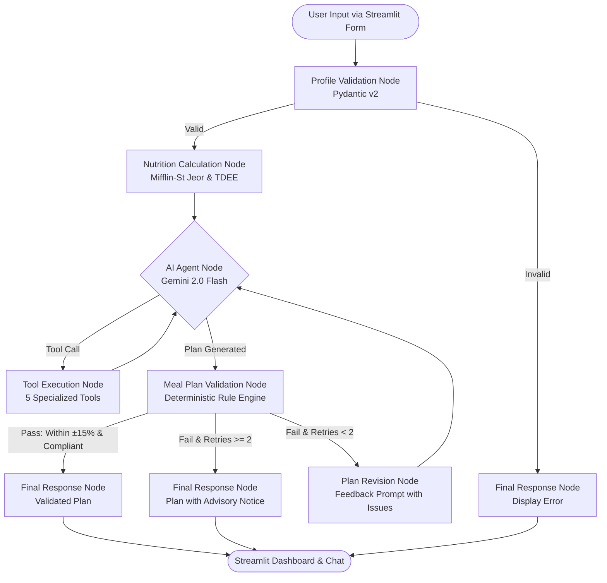

# 🥗 AI-Based Food and Nutrition Planning Agent

An autonomous Agentic AI system that computes personalized biometric energy requirements, searches curated Indian foods (ICMR-NIN), generates balanced 4-meal daily plans, and self-validates dietary compliance using Google Gemini 2.0 Flash and LangGraph.

[](https://www.python.org/)
[](https://deepmind.google/technologies/gemini/)
[](https://langchain-ai.github.io/langgraph/)
[](https://streamlit.io/)
[-brightgreen.svg)](tests/)

---

## 📌 Problem Statement

Dietary planning in India often suffers from:
1. **Generic Advice:** Western diet formulas ignore Indian staple food compositions, cooking mediums, and carbohydrate-to-protein distributions.
2. **Allergen & Preference Violations:** Manually crafted plans or standard LLMs frequently hallucinate or accidentally suggest non-vegetarian foods or allergen-tagged items (e.g. dairy or peanuts).
3. **Caloric Imbalance:** Plans frequently miss daily caloric and macronutrient targets by substantial margins without self-correcting mechanisms.

---

## 🎯 Objectives

- **Scientific Calculation Engine:** Implement the **Mifflin-St Jeor** formula to calculate Basal Metabolic Rate (BMR), adjust for Physical Activity Level (PAL) to compute Total Daily Energy Expenditure (TDEE), and derive goal-specific daily macronutrient targets.
- **Curated Indian Dataset:** Compile an authenticated 57-item Indian food composition dataset based on **ICMR-National Institute of Nutrition (NIN)** data with vegetarian, non-vegetarian, macronutrient, allergen, and glycemic index tags.
- **Agentic AI & Self-Healing Loop:** Leverage **Google Gemini 2.0 Flash** bound with 5 specialized Python tools and a 7-node **LangGraph** StateGraph that automatically validates meal plans and triggers up to 2 corrective revisions if constraints are violated.
- **Interactive Web Interface:** Provide a responsive Streamlit dashboard with biometric metric cards, meal-wise breakdown tables, distribution charts, and a multi-turn chat assistant with session memory.

---

## 🛠️ Technologies Used

| Layer | Technology | Purpose |
|---|---|---|
| **AI Reasoning** | Google Gemini 2.0 Flash | Autonomous reasoning, tool calling, and dietary advice |
| **Agent Framework** | LangGraph & LangChain Core | StateGraph orchestration, conditional edges, memory checkpointer |
| **Data & Descriptors** | Pandas & NumPy | Vectorized database filtering and cosine similarity ranking |
| **Validation** | Pydantic v2 & Pydantic-Settings | Typed schemas, configuration management, strict input validation |
| **User Interface** | Streamlit | Responsive dashboard, KPI cards, meal tables, and chat assistant |
| **Testing** | Pytest & Pytest-Cov | 49-point automated test suite with 100% pass rate |

---

## 🏛️ System Architecture



---

## 🧰 Python Tools

The agent invokes five dedicated Python tools:

1. **`calculate_nutrition_targets`**: Derives BMI, BMR, TDEE, Calorie targets, and Protein, Carbohydrate, Fat, and Fiber gram goals.
2. **`search_food_database`**: Vectorized search filtering by diet type (`veg`/`non-veg`), meal slot (`breakfast`, `lunch`, `snack`, `dinner`), calorie cap, and excluded allergen tags.
3. **`calculate_meal_nutrition`**: Computes exact cumulative calories and macro breakdown for any combination of foods and gram portion sizes.
4. **`find_food_substitutes`**: Identifies alternative foods ranked by **cosine similarity** on the normalized macro vector `[calories, protein, carbs, fats, fiber]`.
5. **`validate_meal_plan`**: Enforces strict deterministic rules:
   - Presence of all required meals (Breakfast, Lunch, Dinner).
   - Positive portion sizes (> 0g).
   - Zero non-vegetarian items in vegetarian plans.
   - Zero allergen items in restricted plans.
   - Zero user-excluded foods.
   - Planned calories strictly within **±15%** of target.

---

## 📂 Project Directory Structure

```
AI-Food-Nutrition-Agent/
│
├── app.py                             # Streamlit main application entry point
├── requirements.txt                   # Production & testing dependencies
├── .env.example                       # Template for API credentials & config
├── .gitignore                         # Git exclusion rules
├── README.md                          # Comprehensive project documentation
│
├── config/
│   ├── __init__.py
│   └── settings.py                    # Pydantic BaseSettings & env loader
│
├── core/
│   ├── __init__.py
│   ├── user_profile.py                # Pydantic v2 UserProfile with field validators
│   ├── calculations.py                # Pure mathematical functions (Mifflin-St Jeor)
│   ├── schemas.py                     # Shared Pydantic data schemas & targets
│   └── validation.py                  # Deterministic meal plan verification engine
│
├── tools/
│   ├── __init__.py
│   ├── nutrition_tools.py             # Tool 1: calculate_nutrition_targets
│   └── food_tools.py                  # Tools 2–5: search, calc, substitute, validate
│
├── agent/
│   ├── __init__.py
│   ├── graph.py                       # LangGraph StateGraph, nodes & conditional edges
│   ├── state.py                       # AgentState TypedDict definition
│   └── prompts.py                     # Expert nutritionist prompts & revision template
│
├── ui/
│   ├── __init__.py
│   ├── profile_form.py                # Biometric & dietary restriction form
│   ├── dashboard.py                   # KPI metrics, macro deltas, meal tables & charts
│   └── chat_interface.py             # Multi-turn chat with session memory
│
├── data/
│   ├── food_data.csv                  # 57 Indian food items (ICMR-NIN curated)
│   └── validate_data.py               # Standalone dataset integrity validator
│
├── tests/
│   ├── __init__.py
│   ├── conftest.py                    # Pytest shared fixtures
│   ├── test_calculations.py           # Unit tests for math formulas & profile checks
│   ├── test_tools.py                  # Unit tests for all 5 Python tools
│   ├── test_agent.py                  # Integration tests for LangGraph nodes & routing
│   └── test_functional_evaluation.py  # 7-scenario functional verification matrix
│
└── evidence/
    ├── evaluation_report.md           # Formal testing & evaluation benchmark report
    └── screenshots/                   # Execution evidence & UI captures
```

---

## 🚀 Installation & Execution

### 1. Clone the Repository
```bash
git clone https://github.com/your-username/AI-Food-Nutrition-Agent.git
cd AI-Food-Nutrition-Agent
```

### 2. Set Up Virtual Environment
```bash
python -m venv venv
# On Windows:
venv\Scripts\activate
# On Linux/macOS:
source venv/bin/activate
```

### 3. Install Dependencies
```bash
pip install -r requirements.txt
```

### 4. Configure API Key
Create a `.env` file in the root directory:
```bash
cp .env.example .env
```
Open `.env` and add your Google Gemini API key:
```ini
GEMINI_API_KEY=your_gemini_api_key_here
MODEL_NAME=gemini-2.0-flash
```
*(You can also input your API key directly inside the Streamlit web sidebar).*

### 5. Run the Application
```bash
streamlit run app.py
```
Open your browser at `http://localhost:8501`.

---

## 🧪 Testing & Evaluation Results

Run the full automated test suite:
```bash
pytest tests/ -v
```

### Summary of Results
- **Collected:** 49 test cases
- **Passed:** 49 (100% Pass Rate)
- **Execution Time:** ~4.05 seconds

### Functional Verification Matrix
| Scenario | Requirement | Status |
|---|---|---|
| **Vegetarian Diet** | Only vegetarian items recommended (no poultry/meat/fish) | ✅ PASS |
| **Non-Vegetarian Diet** | Suitable non-vegetarian options included | ✅ PASS |
| **Allergy Exclusion** | Strict exclusion of allergen-tagged items (peanuts, dairy, etc.) | ✅ PASS |
| **Food Substitution** | High cosine similarity alternatives (> 0.85) returned | ✅ PASS |
| **Input Validation** | Halts out-of-range age (<10), invalid allergens, or negative values | ✅ PASS |
| **Self-Correction** | Rejection feedback loop corrects violating meal plans (max 2 retries) | ✅ PASS |
| **Offline Resilience** | Graceful fallback when Gemini API key is missing | ✅ PASS |

Full evaluation benchmark details are documented in [evidence/evaluation_report.md](evidence/evaluation_report.md).

---

## 📜 License & Credits

- **Food Composition Data:** Derived from Indian Food Composition Tables (IFCT) — National Institute of Nutrition (ICMR-NIN).
- **Formulas:** Mifflin-St Jeor BMR Equation & WHO Guidelines.
