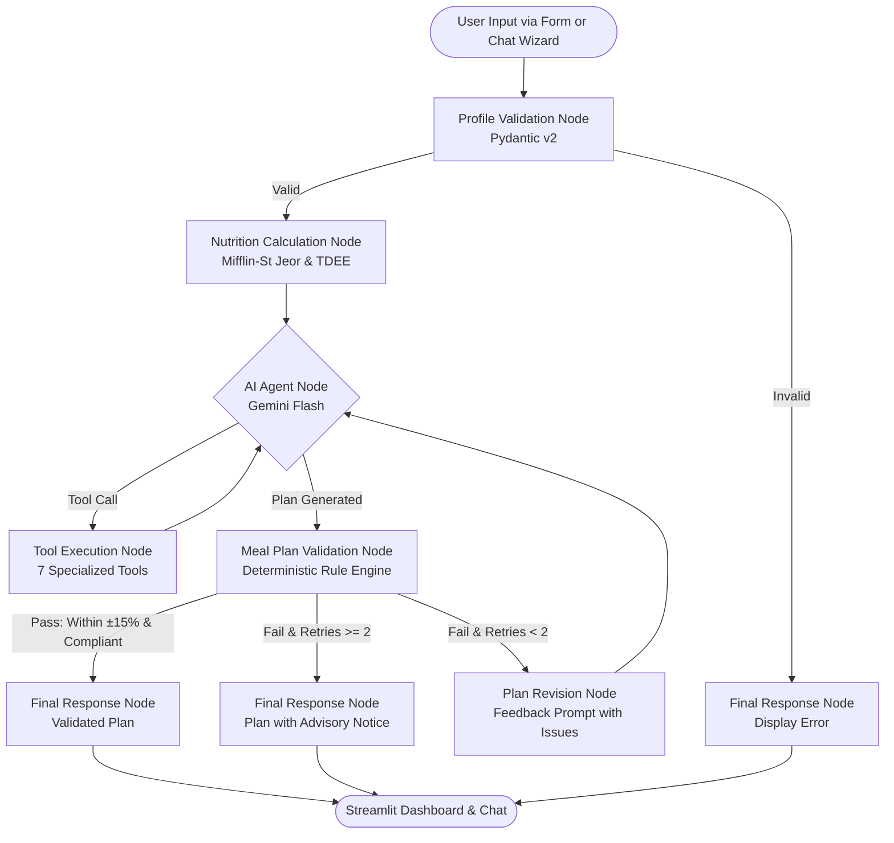

# 🌿 AI-Based Food and Nutrition Planning Agent

An autonomous Agentic AI system that computes personalized biometric energy requirements, searches curated Indian foods (ICMR-NIN), generates balanced 7-day meal plans (Monday to Sunday), calculates detailed macronutrients and micronutrients (Vitamins & Minerals), and self-validates dietary compliance using Google Gemini Flash, LangGraph, and RAG.

[](https://www.python.org/)
[](https://deepmind.google/technologies/gemini/)
[](https://langchain-ai.github.io/langgraph/)
[](https://streamlit.io/)
[-brightgreen.svg)](tests/)
[](rag/)

---

## 📌 Problem Statement

Dietary planning in India often suffers from:
1. **Generic Advice:** Western diet formulas ignore Indian staple food compositions, cooking mediums, and carbohydrate-to-protein distributions.
2. **Allergen & Preference Violations:** Manually crafted plans or standard LLMs frequently hallucinate or accidentally suggest non-vegetarian foods or allergen-tagged items (e.g. dairy or peanuts).
3. **Caloric Imbalance:** Plans frequently miss daily caloric and macronutrient targets by substantial margins without self-correcting mechanisms.

---

## 🎯 Objectives

- **Scientific Calculation Engine:** Implement the **Mifflin-St Jeor** formula to calculate Basal Metabolic Rate (BMR), adjust for Physical Activity Level (PAL) to compute Total Daily Energy Expenditure (TDEE), and derive goal-specific daily macronutrient targets.
- **Curated Indian Dataset:** Compile an authenticated 57-item Indian food composition dataset based on **ICMR-National Institute of Nutrition (NIN)** data with vegetarian, non-vegetarian, macronutrient, allergen, and glycemic index tags.
- **Agentic AI & Self-Healing Loop:** Leverage **Google Gemini Flash** bound with 7 specialized Python tools and a 7-node **LangGraph** StateGraph that automatically validates meal plans and triggers up to 2 corrective revisions if constraints are violated. A model fallback chain and deterministic offline answers keep every feature working when a model is retired or the API is unreachable.
- **Interactive Web Interface:** Provide a responsive Streamlit dashboard with biometric metric cards, meal-wise breakdown tables, distribution charts, a multi-turn chat assistant with session memory, and an optional one-question-at-a-time profile wizard alongside the classic form.

---

## 🛠️ Technologies Used

| Layer | Technology | Purpose |
|---|---|---|
| **AI Reasoning** | Google Gemini Flash (`gemini-flash-lite-latest`) | Autonomous reasoning, tool calling, and dietary advice |
| **Agent Framework** | LangGraph & LangChain Core | StateGraph orchestration, conditional edges, memory checkpointer |
| **Knowledge Retrieval (RAG)** | FAISS + pure-Python BM25, HuggingFace (`all-MiniLM-L6-v2`) | Hybrid dense/lexical retrieval with reciprocal rank fusion over core and condition indexes |
| **Document Processing** | PyPDFLoader & RecursiveSplitter | PDF parsing, chunking (600 chars / 120 overlap) with source/page/condition metadata |
| **Data & Descriptors** | Pandas & NumPy | Vectorized database filtering and cosine similarity ranking |
| **Validation** | Pydantic v2 & Pydantic-Settings | Typed schemas, configuration management, strict input validation |
| **User Interface** | Streamlit | Responsive dashboard, KPI cards, meal tables, and chat assistant |
| **Testing** | Pytest & Pytest-Cov | 173-test automated suite with 100% pass rate |

---

## 🏛️ System Architecture



---

## 🧰 Python Tools

The agent invokes seven dedicated Python tools:

1. **`calculate_nutrition_targets`**: Derives BMI, BMR, TDEE, Calorie targets, and Protein, Carbohydrate, Fat, and Fiber gram goals.
2. **`search_food_database`**: Vectorized search filtering by diet type (`veg`/`non-veg`), meal slot (`breakfast`, `lunch`, `snack`, `dinner`), calorie cap, and excluded allergen tags.
3. **`calculate_meal_nutrition`**: Computes exact cumulative calories and macro breakdown for any combination of foods and gram portion sizes.
4. **`find_food_substitutes`**: Identifies alternative foods ranked by **cosine similarity** on the normalized macro vector `[calories, protein, carbs, fats, fiber]`.
5. **`validate_meal_plan`**: Enforces strict deterministic rules:
   - Presence of all required meals (Breakfast, Lunch, Dinner).
   - Positive portion sizes (> 0g).
   - Zero non-vegetarian items in vegetarian plans.
   - Zero allergen items in restricted plans.
   - Zero user-excluded foods.
   - Planned calories strictly within **±15%** of target.
6. **`retrieve_nutrition_knowledge`**: Distance-filtered ICMR-NIN RAG tool with
   composed answers and source/page citations.
7. **`retrieve_hybrid_nutrition_knowledge`**: Fuses dense FAISS + BM25 with
   reciprocal rank fusion across the core and condition indexes, and appends a
   deterministic citation-verification result to every answer.

---

## 📂 Project Directory Structure

```
AI-Food-Nutrition-Agent/
│
├── app.py                             # Streamlit main application entry point
├── requirements.txt                   # Production & testing dependencies
├── .env.example                       # Template for API credentials & config
├── .gitignore                         # Git exclusion rules
├── README.md                          # Comprehensive project documentation
│
├── config/
│   ├── __init__.py
│   └── settings.py                    # Pydantic BaseSettings & env loader
│
├── core/
│   ├── __init__.py
│   ├── user_profile.py                # Pydantic v2 UserProfile with field validators
│   ├── calculations.py                # Pure mathematical functions (Mifflin-St Jeor)
│   ├── schemas.py                     # Shared Pydantic data schemas & targets
│   ├── validation.py                  # Deterministic meal plan verification engine
│   ├── citations.py                   # Rule-based citation & numeric-claim verifier
│   └── profile_wizard.py              # Headless one-question-at-a-time profile state machine
│
├── tools/
│   ├── __init__.py
│   ├── nutrition_tools.py             # Tool 1: calculate_nutrition_targets
│   └── food_tools.py                  # Tools 2–5: search, calc, substitute, validate
│
├── agent/
│   ├── __init__.py
│   ├── graph.py                       # LangGraph StateGraph, nodes & conditional edges
│   ├── state.py                       # AgentState TypedDict definition
│   └── prompts.py                     # Expert nutritionist prompts & revision template
│
├── ui/
│   ├── __init__.py
│   ├── profile_form.py                # Page 1: 4-section biometric & goal profile form
│   ├── profile_wizard.py              # Optional chat-style profile wizard (form stays default)
│   ├── dashboard.py                   # Page 2: KPI metrics, macro distributions, charts
│   ├── meal_planner.py                # Page 3: 7-day meal cards, micronutrients, weekly analytics
│   ├── food_database.py               # Page 4: 57-item food composition & micronutrient inspector
│   ├── chat_interface.py             # Page 5: Multi-turn AI Nutritionist chat with RAG
│   └── styles.py                      # Modern theme CSS, dark green/mint palette & cards
│
├── data/
│   ├── food_data.csv                  # 57 Indian food items (ICMR-NIN curated)
│   ├── micronutrient_data.py          # IFCT 2017 vitamins & minerals + RDA 2020 targets
│   └── validate_data.py               # Standalone dataset integrity validator
│
├── rag/
│   ├── __init__.py
│   ├── document_loader.py             # PyPDFLoader wrappers for both document collections
│   ├── document_sources.py            # Manifest: provenance + health-condition tags per PDF
│   ├── text_splitter.py               # RecursiveCharacterTextSplitter chunking
│   ├── embeddings.py                  # HuggingFace sentence-transformers local embeddings
│   ├── vector_store.py                # FAISS indexing and persistent storage
│   ├── retriever.py                   # Calibrated distance-filtered retriever & LangChain tool
│   ├── ingest.py                      # CLI for rebuilding named collections with metadata
│   ├── condition_retriever.py         # Additive filtered retrieval over the condition index
│   ├── sparse_index.py                # Dependency-free Okapi BM25 lexical index
│   ├── hybrid_retriever.py            # FAISS + BM25 reciprocal rank fusion & cited answers
│   └── evaluate_rag.py                # 16-query RAG factual accuracy & rejection benchmark
│
├── knowledge_base/
│   ├── nutrition_documents/           # Core ICMR-NIN reference PDF (see note below)
│   ├── condition_documents/           # 6 condition PDFs (PCOS, thyroid, BP, lactose, obesity, sleep)
│   ├── SOURCES.md                     # Provenance, condition tags and rebuild instructions
│   ├── build_sample_documents.py      # Regenerates the bundled reference PDF
│   ├── faiss_index/                   # Core FAISS index (index.faiss, index.pkl)
│   └── condition_faiss_index/         # Condition-specific FAISS index
│
├── tests/
│   ├── __init__.py
│   ├── conftest.py                    # Pytest shared fixtures
│   ├── test_calculations.py           # Unit tests for math formulas & profile checks (20 tests)
│   ├── test_tools.py                  # Unit tests for all 5 Python tools (10 tests)
│   ├── test_agent.py                  # Integration tests for LangGraph nodes & routing (9 tests)
│   ├── test_functional_evaluation.py  # 7-scenario functional verification matrix (10 tests)
│   ├── test_offline_and_live.py       # Offline fallback & live API routing tests (4 tests)
│   ├── test_rag.py                    # Unit & integration tests for RAG pipeline (18 tests)
│   ├── test_7day_upgrade.py           # 15-scenario verification for 7-day meal planning & UI (15 tests)
│   ├── test_complete_system_verification.py  # End-to-end system verification (10 tests)
│   ├── test_regressions.py            # Audit regression tests: parsing, safety & allergens (11 tests)
│   ├── test_audit_validation_and_accuracy.py  # Validation and micronutrient audit (13 tests)
│   ├── test_ui_frontend.py            # Streamlit AppTest smoke tests for all five pages (8 tests)
│   ├── test_ingestion.py              # Multi-collection ingestion & condition retrieval (12 tests)
│   ├── test_hybrid_and_citations.py   # BM25, hybrid RRF fusion & citation checks (16 tests)
│   └── test_profile_wizard.py         # Wizard state machine & AppTest chat flow (13 tests)
│
└── evidence/
    ├── evaluation_report.md           # Formal testing & evaluation benchmark report
    └── screenshots/                   # Execution evidence & UI captures
```

> **Reference-document note:** `knowledge_base/nutrition_documents/` contains a
> generated reference PDF used by the bundled demo index. Its text is a curated
> summary written for demonstration, not the official ICMR-NIN publication. For
> production use, replace it with the official ICMR-NIN Dietary Guidelines PDF
> and rebuild the index with `python -m rag.ingest --collection core --rebuild`
> (see [knowledge_base/SOURCES.md](knowledge_base/SOURCES.md) for full provenance
> of both document collections).

---

## 🚀 Installation & Execution

### 1. Clone the Repository
```bash
git clone https://github.com/your-username/AI-Food-Nutrition-Agent.git
cd AI-Food-Nutrition-Agent
```

### 2. Set Up Virtual Environment
```bash
python -m venv venv
# On Windows:
venv\Scripts\activate
# On Linux/macOS:
source venv/bin/activate
```

### 3. Install Dependencies
```bash
pip install -r requirements.txt
```

### 4. Configure API Key
Create a `.env` file in the root directory:
```bash
cp .env.example .env
```
Open `.env` and add your Google Gemini API key:
```ini
GOOGLE_API_KEY=your_gemini_api_key_here
MODEL_NAME=gemini-flash-lite-latest
```
*(Security Note: API keys are loaded strictly from the environment/.env on the backend. No API keys are ever requested or entered through the Streamlit web interface. If no API key is provided, the application automatically activates its deterministic offline ICMR-NIN demo planner).*

The embedding model downloads once from HuggingFace on first use. For an
air-gapped demo, pre-download the model and set `NUTRITION_OFFLINE=1`.

### 5. Build Knowledge Base & Run Application
Both FAISS indexes are shipped with the repository, so this step is optional.
To rebuild them from the bundled PDFs (local embeddings, no API key needed):
```bash
python -m rag.ingest --collection core --rebuild
python -m rag.ingest --collection conditions --rebuild
```
Use `--dry-run` first to inspect the document manifest without embedding.
Start the Streamlit application:
```bash
streamlit run app.py
```
Open your browser at `http://localhost:8501`.

### Profile input modes
The **👤 My profile** page offers two opt-in modes:

- **Form** (default) — the original four-section form with quick-start presets.
- **Chat wizard** — asks for one field at a time in a chat bubble, understands
  everyday answers (`milk` → `dairy`, `5'7` → `170 cm`, `lose` → `weight_loss`),
  retries invalid answers, and lets you skip optional fields. It finishes with a
  review summary and a **Create plan with this profile** button.

Both paths call the same `UserProfile` Pydantic validator, so the generated plan
is identical. The wizard lives in `core/profile_wizard.py` (headless state
machine) and `ui/profile_wizard.py` (Streamlit chat UI); nothing is saved until
you submit.

---

## 🧪 Testing & Evaluation Results

Run the full automated test suite:
```bash
pytest tests/ -v
```

### Summary of Results
- **Collected:** 173 test cases across 14 test modules
- **Passed:** 173 (100% Pass Rate)
- **Execution Time:** ~90 seconds (fully offline and deterministic)

### Module Breakdown
| Test Module | Coverage Area | Status |
|---|---|---|
| `test_calculations.py` | Mifflin-St Jeor BMR, TDEE, macro splits, validators (20 tests) | ✅ 20 PASS |
| `test_tools.py` | Vectorized food search, macro calculation, substitutions, validation (10 tests) | ✅ 10 PASS |
| `test_agent.py` | LangGraph nodes, state routing, conditional edges, retry limits (9 tests) | ✅ 9 PASS |
| `test_functional_evaluation.py` | End-to-end user journeys: Veg, Non-Veg, Allergies, Substitutions (10 tests) | ✅ 10 PASS |
| `test_offline_and_live.py` | Graceful offline demo planner & chat fallback (4 tests) | ✅ 4 PASS |
| `test_rag.py` | PDF loading, chunking, embeddings, FAISS search, distance rejection (22 tests) | ✅ 22 PASS |
| `test_7day_upgrade.py` | 15-scenario verification: 7-day plans, allergens, micronutrients, calculations (15 tests) | ✅ 15 PASS |
| `test_complete_system_verification.py` | End-to-end biometrics, tools, multi-user planning, RAG, chat, UI imports (10 tests) | ✅ 10 PASS |
| `test_regressions.py` | Nested JSON parsing, malformed-plan safety, allergen consistency, stale state (11 tests) | ✅ 11 PASS |
| `test_audit_validation_and_accuracy.py` | Audit of validation, micronutrients and profile-aware chat safety (13 tests) | ✅ 13 PASS |
| `test_ui_frontend.py` | Streamlit AppTest smoke tests for all five pages and chips (8 tests) | ✅ 8 PASS |
| `test_ingestion.py` | Manifest, dry-run/rebuild ingestion and condition retrieval (12 tests) | ✅ 12 PASS |
| `test_hybrid_and_citations.py` | BM25, RRF fusion, filtering and citation verification (16 tests) | ✅ 16 PASS |
| `test_profile_wizard.py` | Headless wizard state machine, parsing, skips, retry and AppTest chat flow (13 tests) | ✅ 13 PASS |

Run the dedicated 16-query RAG factual accuracy and rejection benchmark:
```bash
python rag/evaluate_rag.py
```

### Functional Verification Matrix
| Scenario | Requirement | Status |
|---|---|---|
| **Vegetarian Diet** | Only vegetarian items recommended (no poultry/meat/fish) | ✅ PASS |
| **Non-Vegetarian Diet** | Suitable non-vegetarian options included | ✅ PASS |
| **Allergy Exclusion** | Strict exclusion of allergen-tagged items (peanuts, dairy, etc.) | ✅ PASS |
| **Food Substitution** | High cosine similarity alternatives (> 0.85) returned | ✅ PASS |
| **Input Validation** | Halts out-of-range age (<10), invalid allergens, or negative values | ✅ PASS |
| **Self-Correction** | Rejection feedback loop corrects violating meal plans (max 2 retries) | ✅ PASS |
| **Offline Resilience** | Graceful fallback when Gemini API key is missing | ✅ PASS |

Full evaluation benchmark details are documented in [evidence/evaluation_report.md](evidence/evaluation_report.md).

---

## 📜 License & Credits

- **Food Composition Data:** Derived from Indian Food Composition Tables (IFCT) — National Institute of Nutrition (ICMR-NIN).
- **Formulas:** Mifflin-St Jeor BMR Equation & WHO Guidelines.
